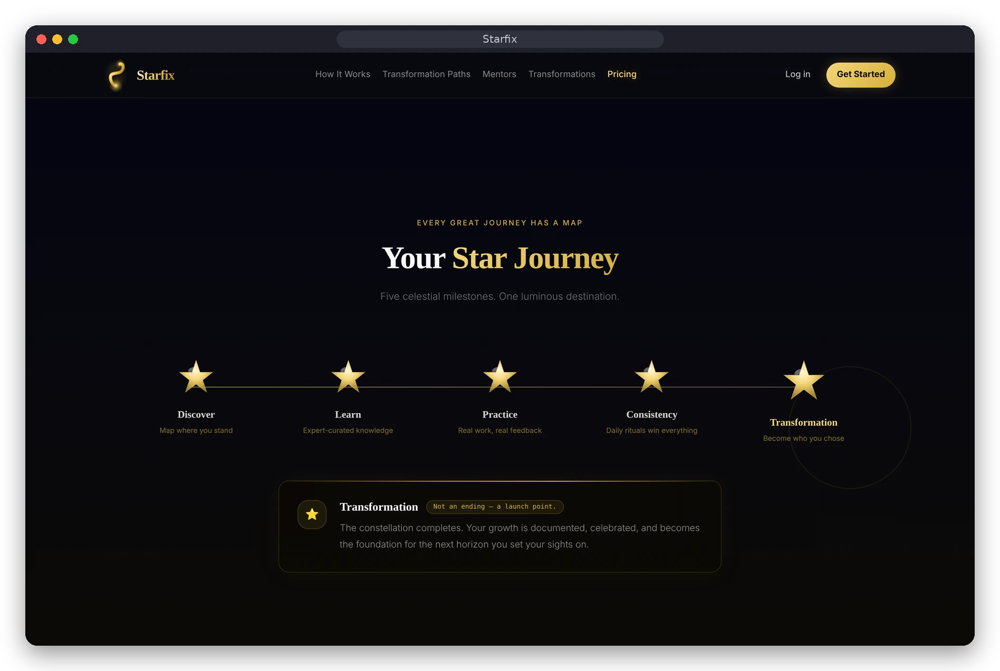
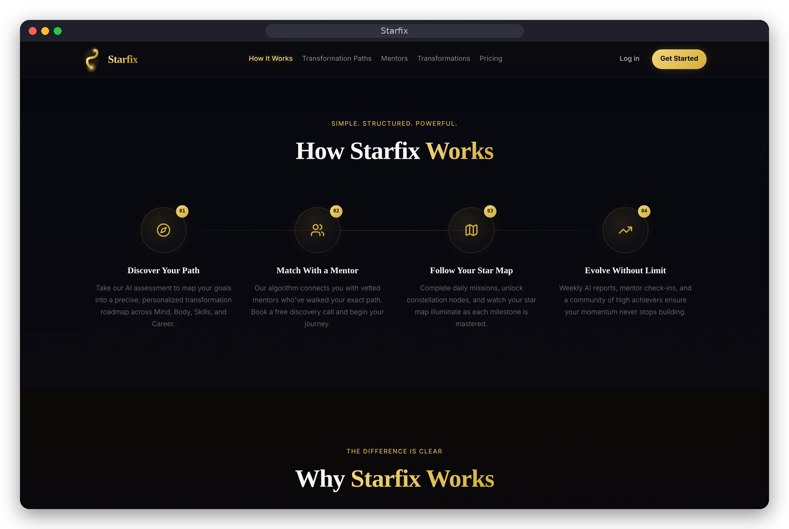
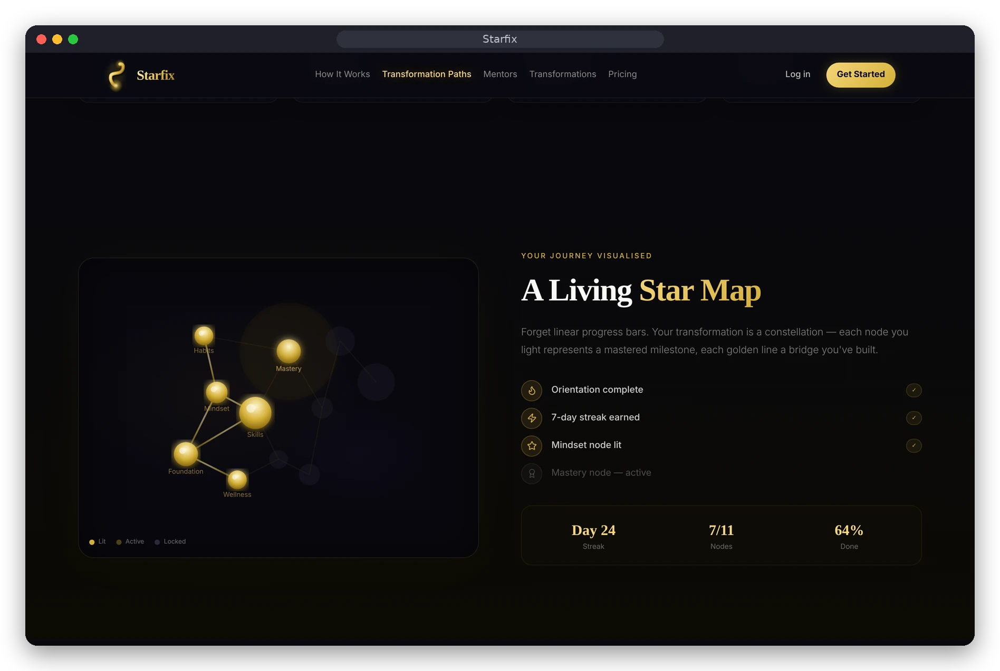
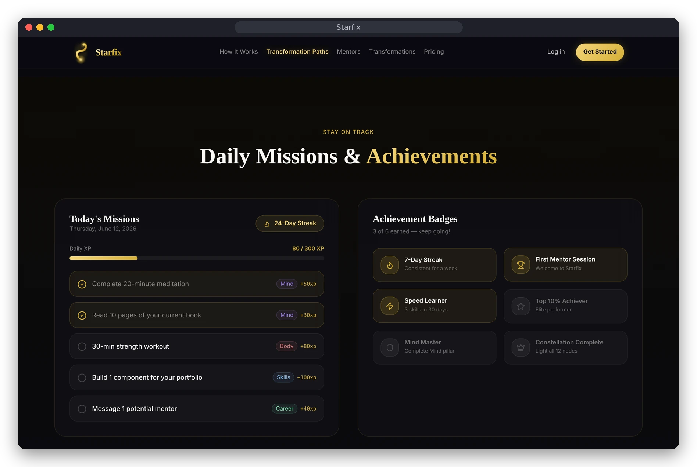
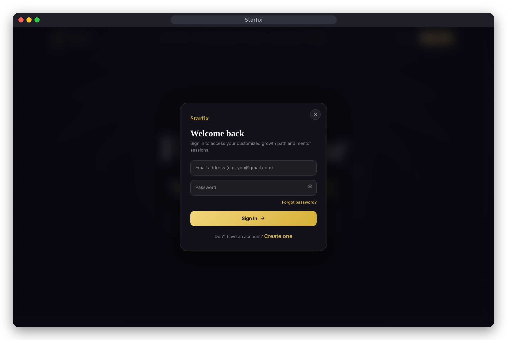

<div align="center">

# ✨ Starfix
### *Mentorship & Personal Growth Platform*

[](https://starfix-website.vercel.app)
[](https://react.dev/)
[](https://www.typescriptlang.org/)
[](https://vitejs.dev/)
[](https://tailwindcss.com/)
[](https://supabase.com/)
[](https://razorpay.com/)

**Find the right mentor. Follow a structured growth path. Track real progress.**

[Live Demo](https://starfix-website.vercel.app) · [Screenshots](#-screenshots) · [Run it locally](#run-it-locally) · [Admin Dashboard](https://github.com/kvalecha186-dot/premium-admin-dashboard)

<br/>


</div>


Starfix is a platform I'm building around one simple idea: finding the right mentor should be easier, and personal growth should be something people can actually track.

The platform brings learners and mentors together. Learners can explore mentors, work towards goals and follow structured growth paths. Mentors get their own space to manage their profiles and mentees, while the admin dashboard gives a broader view of what's happening across the platform.

This repository contains the main Starfix web application.

## 📸 Screenshots

<table>
  <tr>
    <td width="50%"><br/><sub><b>Star Journey</b> — five milestones from Discover to Transformation</sub></td>
    <td width="50%"><br/><sub><b>How it works</b> — path, mentor, star map, growth</sub></td>
  </tr>
  <tr>
    <td width="50%"><br/><sub><b>Star Map</b> — progress shown as a constellation of milestones</sub></td>
    <td width="50%"><br/><sub><b>Daily missions &amp; achievements</b> — XP, streaks and badges</sub></td>
  </tr>
  <tr>
    <td width="50%"><br/><sub><b>Pricing</b> — Explorer, Accelerator and Visionary plans</sub></td>
    <td width="50%"><br/><sub><b>Authentication</b> — email and password sign-in</sub></td>
  </tr>
</table>

> Screenshots are captured from the running application's public pages. Learner, mentor and admin screens sit behind sign-in and are not shown here.

## What you can do with Starfix

### For learners
- Create an account and sign in using the authentication flows.
- Set up a profile and explore growth areas.
- Browse mentors and view mentor information.
- Work with growth paths, goals and milestones.
- Track progress through XP, streaks and activity.
- Book mentorship sessions and follow booking/payment status.
- Use the learner dashboard, profile and account settings.

### For mentors
- Set up and manage a mentor profile.
- View mentees and their progress.
- Manage mentorship-related activity and sessions.
- Work with goals, milestones, resources and feedback.
- Use mentor-focused dashboard screens and settings.

### Platform features
- Separate learner and mentor experiences.
- Email/password and email OTP authentication flows.
- Booking and payment workflow integration.
- Notifications and messaging-related screens.
- Progress tracking and gamified elements such as XP and streaks.
- A separate admin dashboard (see the companion repository below).

> Starfix is actively being developed. The screens and code cover a broad set of workflows, but not every feature should be assumed to be production-ready. Backend availability, environment configuration, payment credentials and end-to-end behaviour still need to be checked in the target environment.

## Tech stack

| Part | Technology |
|---|---|
| UI | React |
| Language | TypeScript |
| Build tool | Vite |
| Styling | Tailwind CSS, with component-level styling |
| Backend services | Supabase |
| Database | PostgreSQL through Supabase |
| Authentication | Supabase Auth |
| Server-side operations | Supabase Edge Functions |
| Payments | Razorpay integration |
| Charts and data visualisation | Recharts |
| Hosting | Vercel |
| Version control | Git and GitHub |

## How the pieces fit together

At a high level, the browser application talks to Supabase for authentication and application data. PostgreSQL stores the platform's records, and Supabase Edge Functions handle server-side operations that should not be trusted to the browser.

The payment flow includes a Razorpay integration. The payment function is kept in the Supabase functions directory rather than putting payment-secret handling in frontend code.

```text
Learner / Mentor
       |
       v
Starfix Web App (React + TypeScript)
       |
       +------ Supabase Auth
       |
       +------ Supabase data layer
       |             |
       |             v
       |        PostgreSQL
       |
       +------ Supabase Edge Functions
                     |
                     v
                Razorpay
                     
Separate companion app:
Starfix Admin Dashboard
```

Some of the main database concepts used by the application include profiles, mentors, growth paths, milestones, bookings, enrolments, user progress, XP transactions, notifications, messages and resources. The SQL files in the `supabase/` directory are the best place to review the schema and database policies.

## Run it locally

### Requirements
- Node.js and npm
- A Supabase project
- The project’s Supabase URL and publishable key

### Setup

```bash
git clone https://github.com/kvalecha186-dot/Starfix-Website.git
cd Starfix-Website
npm install
```

Create a local `.env` file using `.env.example` as the reference:

```env
VITE_SUPABASE_URL=https://your-project-ref.supabase.co
VITE_SUPABASE_PUBLISHABLE_KEY=your_supabase_publishable_key
```

Then start the development server:

```bash
npm run dev
```

Create a production build with:

```bash
npm run build
```

Do not commit real credentials, service-role keys, payment secrets or other private environment values.

## Repository map

```text
.
├── src/
│   └── app/
│       ├── components/       # Shared UI and application components
│       ├── lib/              # Supabase, data and application services
│       ├── mentor/           # Mentor experience and related services
│       └── ...
├── supabase/
│   ├── functions/            # Edge Functions, including payment operations
│   └── ...                   # SQL schema and policy files
├── public/
├── .env.example
├── package.json
└── vite.config.ts
```

The exact feature and component structure is continuing to evolve, so the source folders are the most up-to-date reference.

## Related project

**Starfix Admin Dashboard** is maintained separately and provides the administration side of the platform:

[github.com/kvalecha186-dot/premium-admin-dashboard](https://github.com/kvalecha186-dot/premium-admin-dashboard)

## Current focus

The next stage is about making the complete product dependable, not just adding more screens:
- Verify the Supabase project, schema and migrations.
- Test learner and mentor access rules and Row Level Security.
- Finish and test the complete booking and payment lifecycle.
- Make sure admin and learner data stays consistent.
- Add stronger automated tests and document deployment configuration.

## Why I built it

I wanted to work on something bigger than a single-page website. Starfix gives me a chance to work across the parts that make up a real product: user flows, role-based experiences, database design, authentication, payments, dashboards and deployment. I'm continuing to build and improve it as I learn more about full-stack development.
